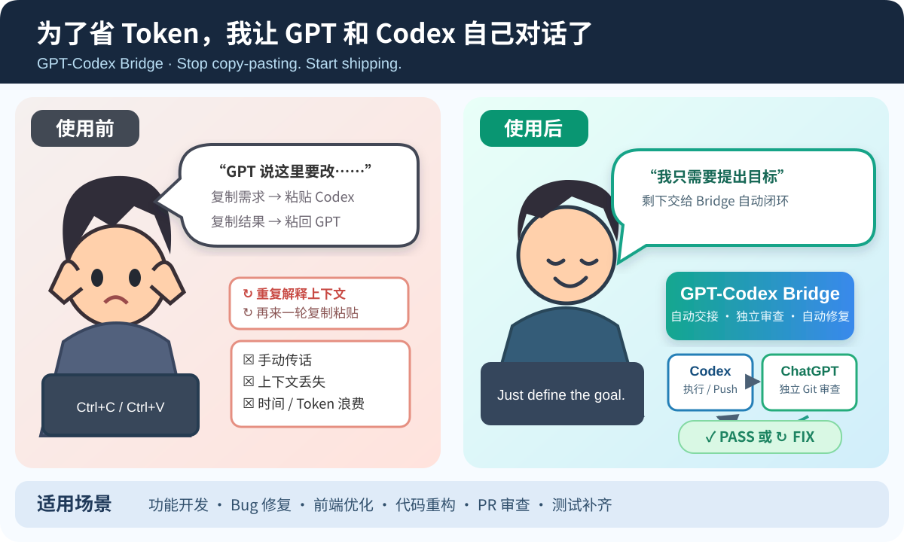

# 为了省 Token，我做了一个让 GPT 和 Codex 自己对话的 Skill

### GPT-Codex Bridge — Stop copy-pasting. Let agents review each other's work.

我原本只想解决一个很小、但每天都在浪费时间的问题：

> 在 ChatGPT 里把需求聊清楚 → 复制给 Codex → 等它写完 → 把结果粘回 GPT → GPT 发现问题 → 再复制回 Codex……
>
> **我不是在开发，我是在给两个 AI 当传话筒。**

而且每换一次窗口，就可能要重新解释背景、贴上长篇上下文、重复对齐验收标准。**为了少浪费这些 Token，也少做这些机械操作，我做了 [`gpt-codex-bridge`](gpt-codex-bridge/)。**

它的目标很直接：**你提出一次需求，让执行 Agent 和 GPT 自己完成「执行 → 审查 → 修复 → 复审」的循环。**



## 你负责定义目标，Agent 负责跑完闭环

```text
你：向 GPT 说清楚目标和验收标准
                 │
                 ▼
       Codex / Luna 等执行 Agent
       读代码 → 修改 → 测试 → Push
                 │
                 ▼
         GitHub：真实代码证据
                 │
                 ▼
    GPT：回到原来的 ChatGPT 对话独立审查
        ├─ PASS  → 完成，停止
        ├─ FIX   → 自动交回执行 Agent 修复
        └─ UNVERIFIED → 补证据，不乱改
                         │
                         └── 修复、测试、Push、再审
```

**不用新开一条丢失上下文的 GPT 对话；不用每轮手动复制粘贴；也不让 Codex 自己宣布“我已经完成了”。**

执行 Agent 使用**用户已授权的浏览器能力**，在你指定的现有 ChatGPT 会话里收发交接；GPT 通过自己的 GitHub 访问读取 **Commit SHA、Diff、相关源码和测试**，而不是只看 Codex 写的总结。

## 适合拿来干什么？

| 场景 | 你以前要做的事 | Bridge 想替你做的事 |
| --- | --- | --- |
| **AI 写代码 / 修 Bug** | 把执行结果转发给 GPT，反复解释哪里还不对 | Codex Push → GPT 审计 → FIX 自动回流 → 再审 |
| **前端 UI / 用户旅程** | 每轮自己充当产品验收负责人 | GPT 按原需求和实际证据指出偏差，Codex 定向修复 |
| **多轮重构 / 测试补齐** | 盯着 Agent 是否漏改、是否只报测试通过 | 核对真实 Diff、测试覆盖及回归风险 |
| **PR 前的质量把关** | 看完自检报告，还得再找一个 AI 审查 | 让不同 Agent 按同一目标交接和复核；PASS 不等于自动合并 |
| **文档 / 研究 / 数据产出** | 在两个窗口重复贴背景、对答案 | 双方能访问同一产物时，也可按证据交接与复核 |

它尤其适合：**任务有明确验收标准，需要多轮迭代，你又不想一直盯着两个 Agent 的场景。**

## 我为什么强调「独立审查」？

很多所谓多 Agent 协作，实际只是：

> Agent A 说做完了 → Agent B 看了 A 的总结 → Agent B 说通过了。

这不叫独立审查。

这个 Skill 用 **GitHub 作为可追溯的代码证据入口**：

- 每轮绑定唯一任务 ID、轮次 ID、基线 SHA 和最新 SHA；
- GPT 自己读取远端提交和相关文件；不能访问就返回 `UNVERIFIED`；
- `FIX` 只反馈一个最重要的修复目标；新提交必须重新审；
- `PASS` 后停止，不擅自合并、部署或发布；
- 消息超时、错轮次、SHA 不匹配时停止，避免误把旧回复当新指令。

**把判断权交给 GPT，把执行权交给 Codex，把可验证的事实留在 GitHub。**

## 3 步开始

**1. 安装 Skill 到 Codex 可发现的用户目录**

```bash
git clone https://github.com/shanwen1/skills.git
mkdir -p ~/.agents/skills
cp -R skills/gpt-codex-bridge ~/.agents/skills/
```

**2. 准备一条已经聊清楚需求的 ChatGPT 对话**

保持登录状态，复制**这条对话的完整 URL**。确认你的 Codex 环境已经具备、且你已授权其访问该页面的浏览器工具。

**3. 告诉 Codex：**

```text
使用 $gpt-codex-bridge。
沿用这条 ChatGPT 对话中的目标与验收标准：
<你的 ChatGPT 对话完整 URL>

在我授权的范围内完成任务，把结果交回该对话让 GPT 独立审查；
若返回 FIX，按唯一优先目标修复并再次交接；PASS 后停止。
不要合并、发布或部署。
```

ChatGPT 项目端可选配 [审查指令](gpt-codex-bridge/CHATGPT_INSTRUCTIONS.md)。详细配置、关联协议和恢复规则见 [Skill 文档](gpt-codex-bridge/README.md)、[SKILL.md](gpt-codex-bridge/SKILL.md)。

## 已经跑通过什么？

在我的实际协作中，已经跑通了 **Chrome 发送交接 → GPT 独立 GitHub 审查 → 返回 FIX → Luna 修复并 Push → GPT 复审新 SHA**。这是一次真实使用反馈，不是拿几个 Agent 人工扮演角色的示意图。

但请注意：

- **它是 Skill，不是一个自带 Chrome 驱动的独立应用。** 必须先有可用、已获授权的浏览器操作能力；不同机器和不同 Agent 的接入可能不同。
- **跨环境安装和完整断线恢复尚未独立验证。** 不能把一次实战成功夸大成“任何电脑一键全自动”。
- **“省 Token”是设计动机，不是经过基准测试的节省率。** 它主要减少反复转述背景、复制长指令和手动衔接；独立审计本身仍会消耗 Token。
- **不默认取得任何更高权限。** 发送消息、Push、浏览器访问都遵循用户授权；没有授权不执行。不会默认合并、发布、部署或接触生产数据。

---

**一句话：我想把时间花在定义问题上，而不是把同一个问题向两个 AI 解释十遍。**

如果你也每天在 ChatGPT 和 Codex 之间来回复制，欢迎试试 **[GPT-Codex Bridge](gpt-codex-bridge/)**。
