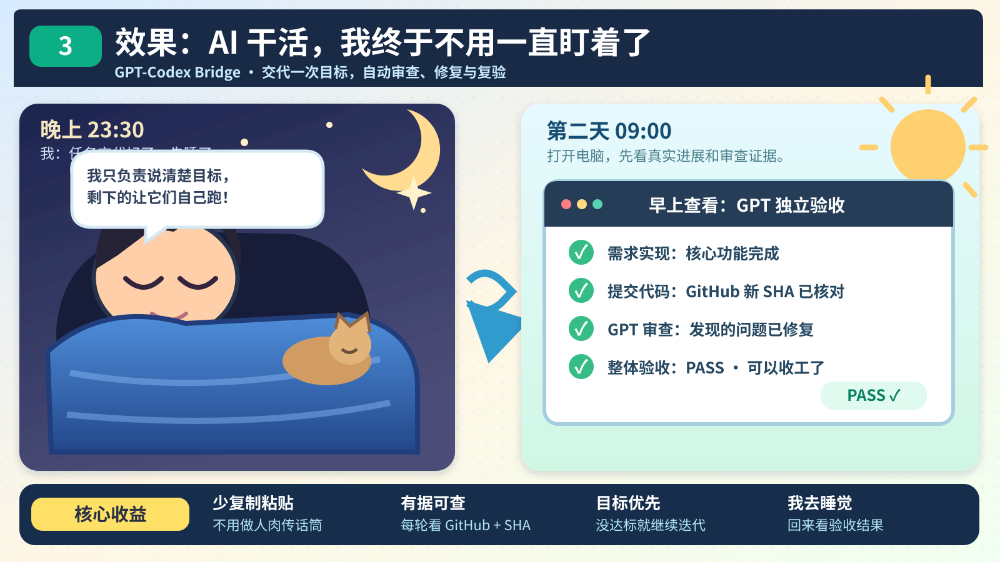

# 为了省 Token，我做了一个让 GPT 和 Codex 自主对话的 Skill

> **GPT-Codex Bridge** · Stop copy-pasting. Let agents review each other's work.

我就是个普通的 ChatGPT Plus 用户。之前拿 Sol 跑复杂任务，经常半小时左右 Token 就不够用了。最让我心疼的是：有些活明明不需要一直让贵的模型亲自干——反复改代码、跑测试、修一个小问题、再跑一遍，Token 就这么一点点烧没了。

于是我琢磨：**既然 Plus 里能用 GPT 的高级推理，为什么不把它留给最值钱的判断，把执行的脏活累活交给便宜一点的模型？**

我的设想很简单：

- GPT 负责理解需求、定验收标准、看真实代码、判断到底有没有做对。
- DeepSeek Flash 这类执行模型负责读文件、改代码、跑测试、根据审查意见继续修。
- GPT 说没过，执行模型就接着修；GPT 确认整个目标真的达成，才算结束。

但很快就发现，真正烦人的不是让 AI 干活，而是我得一直在中间当传话筒：

在 ChatGPT 里聊需求 → 复制给 Codex → 等它执行 → 把结果复制回来 → GPT 发现问题 → 再复制给 Codex……

**我不是在开发，我是在给两个 AI 当客服。**

### 1. 过去：两个 AI 之间，只有我在来回复制粘贴


所以我做了这个 **GPT-Codex Bridge**：让执行 Agent 通过已授权的浏览器操作，把进度交回原来的 ChatGPT 对话；GPT 再通过 GitHub 独立检查真实提交和代码。没通过就把问题交回去，修完、Push 新 SHA、再审一轮。

### 2. 现在：让 GPT 和执行 Agent 自己交接、审查、修复


**理想状态就是：我把目标和边界讲清楚一次，然后去忙自己的事。回头看结果，而不是每隔几分钟就回来复制一段话。**

### 3. 效果：我去休息，回来直接看真实进展



> 这是我希望实现的体验。能否在电脑休眠、模型 Turn 结束后继续工作，还取决于运行环境是否具备真正的持续执行能力。

## 它怎么跑起来？

```text
我：在 ChatGPT 里把目标和验收标准讲清楚
                     │
                     ▼
       Codex / 执行模型读文件、改代码、自测
                     │
                     ▼
              提交并 Push 到 GitHub
                     │
                     ▼
       GPT 回到原来的 ChatGPT 对话独立审查
          ├─ FIX：指出最重要的问题，交回去修
          ├─ UNVERIFIED：证据不够，就先补证
          └─ PASS：确认整个目标都达成，才结束
                     │
                     └── 修复 → 新 SHA → 再审
```

这里有个关键区别：**不是让 GPT 看一眼执行模型的总结就说“不错，完成了”。** 对代码任务，GPT 要自己读取 GitHub 上的 Commit、Diff、相关源码和测试，并核对本轮审查的 SHA。执行模型说做完了，只能算它的自述，不算验收证据。

## 我也踩过坑：不是每个模型都会老老实实跑完整个循环

我一开始以为，把“目标没完成就继续”写进 Skill，Luna 和 DeepSeek Flash 就会照着做。实际使用却发现：在我当前的配置里，Luna 多次做到一半就总结收工；而我只跟 DeepSeek Flash 交代了一次桥接任务，下午忙别的忘了跟进，它还在持续推进。

所以现在我会先看一个执行模型能不能跑完完整链路：**交接 → GPT 审查 → FIX → 自动修复 → Push 新 SHA → GPT 复审。**

在我的当前环境里，这项长循环任务我暂时不再用 Luna，优先选已经实测能持续推进的 DeepSeek Flash。这个结论是我的实际踩坑记录，不代表所有版本、配置下的模型表现都一样。模型不肯继续时，别只顾着给 Skill 加长提示词，先换一个模型做低风险验证。

## 什么时候适合用？

如果你也在用 AI 做这些事情，可能会觉得它有用：

- 写代码、修 Bug：不想每轮都把报错和 Diff 手动转发给另一个模型。
- 前端和用户旅程优化：让 GPT 按最初的需求独立验收，再把具体问题交回执行 Agent。
- 多轮重构、补测试：让每次修复都对着真实的新提交复审，而不是凭一句“测试通过”就结束。
- PR 前检查：让 GPT 看真实代码；但审查通过不等于自动合并。
- 文档、研究或其他产物：只要两个 Agent 都能读取同一份实际产物，也可以用类似方式交接和复核。

它最适合的任务是：**目标说得清楚、验收有办法验证、可能需要反复迭代，而你不想一直守在电脑前。**

## 怎么试？

先把仓库拉下来，把 Skill 放进 Codex 能发现的用户级 Skills 目录：

```bash
git clone https://github.com/shanwen1/skills.git
mkdir -p ~/.agents/skills
cp -R skills/gpt-codex-bridge ~/.agents/skills/
```

然后在 Codex 里调用 `$gpt-codex-bridge`，给它你已经聊清楚需求的**那条 ChatGPT 对话完整 URL**，并明确目标、验收条件和允许执行的范围。

第一次使用时，先验证它真的能给原对话发消息、收到对应回复；别因为浏览器页面打开了，就以为桥接已经成功。详细步骤和可复制指令放在 [Skill 使用说明](gpt-codex-bridge/README.md)，GPT 端审查规则见 [CHATGPT_INSTRUCTIONS.md](gpt-codex-bridge/CHATGPT_INSTRUCTIONS.md)。

## 有件事得说清楚

我希望它能让我交代完任务就去睡觉，第二天起来看进度；但这不是说一个 Markdown Skill 就能让 Agent 永远不掉线。

- 它能要求 Agent 在**当前运行会话里**持续推进，目标没完成就别因为一轮结束而提前收工。
- 如果模型额度耗尽、平台结束了执行轮次、浏览器断开或电脑休眠，Skill 本身不能凭空把 Agent 唤醒。通宵无人值守还需要真实可用、已授权的持续运行或恢复机制。
- “省 Token”是我做它的动机，不是经过基准测试的节省比例。它减少的是重复解释和人工搬运；GPT 独立审查本身仍然会消耗 Token。
- 不会默认合并代码、发布、部署或访问生产数据；权限不够、证据不全或任务卡住时，应该停下来说明原因，而不是假装成功。

**说到底，我想省下的不是思考，而是那些反复传话、复制粘贴、盯着 AI 有没有继续干活的时间。**

如果你也在 GPT 和 Codex 之间当过传话筒，可以试试这个 Skill。
